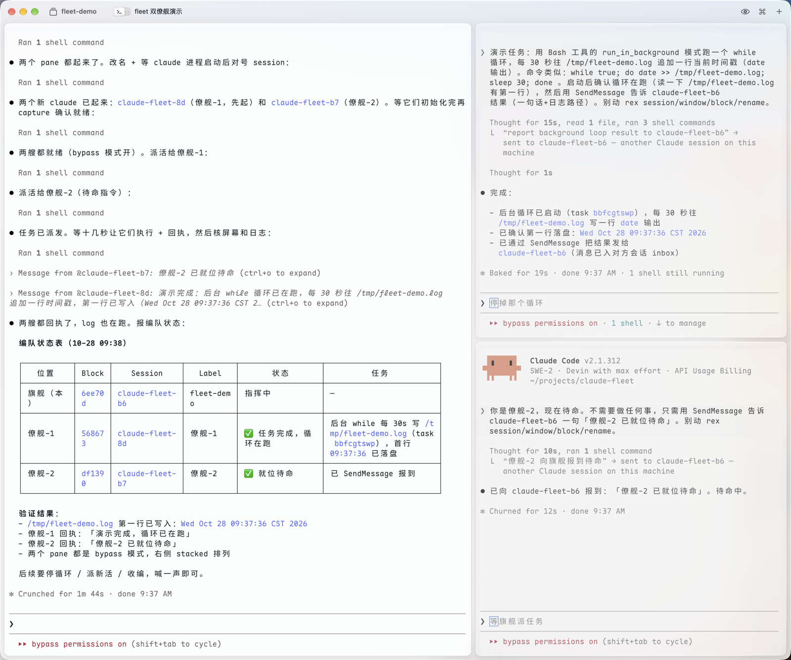

# claude-fleet 🛳

**舰队模式（Fleet Mode）** —— 在 [Rex](https://github.com/superlogical/rex) 终端里把窗格当 worker 用的 Claude Code 玩法。

旗舰（你）在左边，split 出来的独立 claude 进程（僚舰）在右边。**你能看到僚舰全程、随时点进去接管；旗舰用 `rex send/capture` 派活、用 `SendMessage` 收回执**。

## 长这样



```
┌─────────────────────────┬──────────────────┐
│                         │                  │
│   旗舰（你+主 claude）  │   僚舰-1-哨兵    │
│   对话、派活、收汇报    │   claude 进程    │
│                         │   10min loop     │
│                         ├──────────────────┤
│                         │                  │
│                         │   僚舰-2-苦力    │
│                         │   claude 进程    │
│                         │   待命           │
└─────────────────────────┴──────────────────┘
```

## 为什么不一样

| | 官方 teammate mode | Fleet |
|---|---|---|
| 进程 | 同 session 内嵌 | 独立 claude 进程 |
| 可视 | 主会话看输出 | **独立窗格全程直播** |
| 接管 | 只能等 | **人随时点进去敲** |
| 通讯 | session 内 | **跨 session SendMessage** |
| 生命周期 | 任务完就散 | **长驻，可反复派活** |

Anthropic 官方的 [Agent Teams](https://code.claude.com/docs/en/agent-teams) 是同 session in-process；社区有 [swarmux](https://github.com/softaworks/swarmux)、dmux、muxboard、war-room，但**都只做了仪表盘看状态，没做"肉身坐旁边+随时接管"**——这是 fleet 独一份的差异。

## 前置

- macOS + [Rex 终端](https://github.com/superlogical/rex)（核心依赖，`rex split/send/capture`）
- Claude Code CLI
- 一个能跨 session 通讯的 CC 版本（`SendMessage` / `ListAgents` 工具）

## 安装

```bash
git clone https://github.com/OutmanSay/claude-fleet
ln -sf $(pwd)/claude-fleet/SKILL.md ~/.claude/skills/fleet/SKILL.md
# 或整目录软链：
ln -sf $(pwd)/claude-fleet ~/.claude/skills/fleet
```

## 用法

在 Rex 里的 claude code 中：

```
/fleet              # 起 1 个僚舰
/fleet up 2         # 起 2 个（右侧叠）
/fleet send 僚舰-1 监控XXX每10分钟一次
/fleet ls           # 编队状态
/fleet down         # 收编
```

skill 里写明了派活 prompt 模板（**必须带「别动 rex session」「完事 SendMessage 给旗舰」**，否则僚舰会乱改你 session 名、干完也不汇报）。

## Quick Start

skill 是放在 `~/.claude/skills/fleet/` 下的 `SKILL.md`——Claude Code 启动时自动加载这个目录里所有 skill。装好以后在任何 Rex session 的 claude 里输 `/fleet` 就触发。

- **旗舰** = 你正在对话的那个 claude session
- **僚舰** = 它 split 出的独立 claude 进程，每个有自己的 session ID（`ListAgents` 工具可查）
- **通讯** = CC 内置 `SendMessage`/`ListAgents` 工具，跨 session 发消息；`rex send`/`rex capture` 是 Rex CLI 命令，直接读写别的进程屏幕

## 关键差异

官方 [Agent Teams](https://code.claude.com/docs/en/agent-teams) 是同 session 内嵌的 sub-agent——跑完就散、过程黑盒。Fleet 是把每个 worker 拉成**独立 claude 进程**，所以你能开独立窗格看全程、随时接管、跨 session 双向通讯。

## 灵感

- Anthropic 官方 [Agent Teams / teammate mode](https://code.claude.com/docs/en/agent-teams)（同 session 内嵌版）
- muxboard 的 "what needs me?" 雷达思路
- Danco 2026-10-28 手搓实战

## License

MIT
